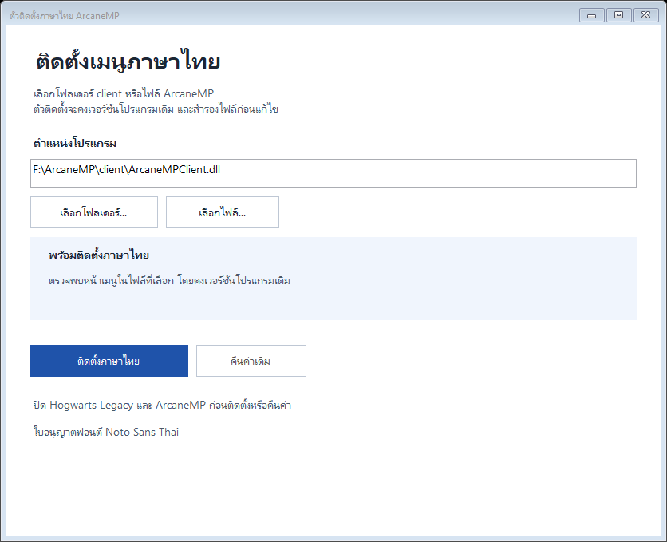

# ArcaneMP Thai Menu Installer

ตัวติดตั้งภาษาไทยแบบ **EXE ไฟล์เดียว** สำหรับเมนูไคลเอนต์ ArcaneMP เลือกโฟลเดอร์ client หรือเลือก `ArcaneMPClient.dll` / `ArcaneMPLauncher.exe` แล้วกดติดตั้งได้เลย ไม่ต้องติดตั้ง Node.js หรือใช้ PowerShell สำหรับการใช้งานปกติ



## ดาวน์โหลดและใช้งาน

ดาวน์โหลด **ArcaneThaiInstaller.exe** จาก [Releases](https://github.com/QUITFIL3/arcanemp-thai-menu/releases/latest)

1. ปิด Hogwarts Legacy และ ArcaneMP
2. เปิด `ArcaneThaiInstaller.exe`
3. กด **เลือกโฟลเดอร์...** หรือ **เลือกไฟล์...** แล้วเลือกตำแหน่งไคลเอนต์
4. เมื่อขึ้น **พร้อมติดตั้งภาษาไทย** ให้กด **ติดตั้งภาษาไทย**
5. เปิดเกมผ่าน ArcaneMP ใหม่

ถ้าต้องการย้อนกลับ ให้เลือกตำแหน่งเดิมแล้วกด **คืนค่าเดิม** ตัวติดตั้งจะหาไฟล์สำรองที่มี checksum ตรงกับไฟล์ปัจจุบัน หากมีแพตช์อื่นอยู่ก่อน การคืนค่าจะกลับไปยังสภาพก่อนติดตั้งครั้งนั้น

ใช้งานบน Windows 10/11 x64 ที่มี .NET Framework 4.8

## เวอร์ชันโปรแกรมเดิม

ตัวติดตั้ง **ไม่อัปเกรดหรือดาวน์เกรด ArcaneMP และไม่เปลี่ยนข้อมูลเวอร์ชันของ client**

- ตรวจหา HTML ของเมนูจากไฟล์ที่เลือกจริง ไม่มีตารางเลขเวอร์ชัน, SHA-256 หรือตำแหน่งไบต์ตายตัวสำหรับอนุญาตการติดตั้ง
- เพิ่มคำแปลและฟอนต์ในหน้าเมนู โดยรักษา JavaScript ของแอปเดิมไว้
- รักษาขนาด DLL และข้อมูลนอกส่วน HTML ทุกไบต์
- เก็บไฟล์ก่อนติดตั้งไว้ใน `client\thai-menu-backups\<เวลา>\ArcaneMPClient.dll`
- อ่านได้ทั้งเมนู HTML เดิมและแพตช์แบบบีบอัดจากชุดก่อน

การรองรับขึ้นกับ **โครงสร้างเมนู** จึงยังไม่รับรองทุกเวอร์ชันในอนาคต หากอ่านโครงสร้างไม่ได้ พบเมนูกำกวม หรือมีพื้นที่ไม่พอ จะหยุดโดยไม่แก้ไฟล์ การอัปเดตจากผู้พัฒนา ArcaneMP อาจคืน DLL ทางการและต้องติดตั้งภาษาไทยอีกครั้ง

## ภาษาไทยครอบคลุมอะไร

เมนูเล่น ไปรษณีย์นกฮูก การตั้งค่าแชตเสียง เสียงเกม กราฟิก และเกี่ยวกับ พร้อมฟอนต์ที่รองรับสระและวรรณยุกต์ แปลข้อความบนหน้าจอโดยรักษารหัส event และค่าของปุ่มไว้


ชื่ออุปกรณ์ ชื่อเซิร์ฟเวอร์ ข้อมูลที่ผู้เล่นกรอก และข้อความใหม่ที่ยังไม่มีคำแปลอาจยังแสดงอังกฤษ ชุดนี้แปลหน้าเมนู client; เควสต์ บทบรรยาย และเมนูเซิร์ฟเวอร์เป็นแพ็กแยกกัน

## การทดสอบ

- ทดสอบติดตั้งซ้ำ คืนค่า checksum ไฟล์สำรอง และการปฏิเสธไฟล์ที่ล็อกหรือพื้นที่ไม่พอ
- ทดสอบกับ PE libraries จำลองที่มี file-version resources `9.8.7.6` และ `7.6.5.4` และตำแหน่งเมนูต่างกัน ยืนยันเวอร์ชัน ขนาด และข้อมูลนอกเมนูไม่เปลี่ยน
- ทดสอบกับสำเนา DLL จริงของ ArcaneMP และสำเนาแพตช์รุ่นก่อน
- ตรวจเมนูที่ได้จาก EXE ด้วย Chromium ทั้ง 4 หมวด รวมฟอนต์ การเลื่อนที่ 1280×720 การสลับโหมดพูด และค่าที่ส่งผ่าน native bridge
- **ยังไม่ได้ยืนยันการทำงานของแพตช์รุ่น EXE ภายในเกมจริง** ภาพเมนูมาจาก Chromium ส่วนภาพตัวติดตั้งเรนเดอร์จาก WinForms

## สร้าง EXE จากซอร์ส

ใช้ C# compiler ของ .NET Framework บน Windows ไม่ต้องติดตั้ง npm dependencies เพื่อสร้าง EXE:

```powershell
.\scripts\build-installer.ps1
```

ผลลัพธ์คือ `dist\ArcaneThaiInstaller.exe` ซึ่งฝังคำแปล ฟอนต์ และใบอนุญาตไว้แล้ว ใช้ไฟล์เดียวได้

สำหรับทดสอบ engine ให้ส่ง DLL ของคุณเอง โดยทดสอบกับสำเนาภายใน `.local/`:

```powershell
.\tests\installer.ps1 -ClientDll "D:\ArcaneMP\client\ArcaneMPClient.dll"
npm ci
npx playwright install chromium
npm run qa:installer
```

คำสั่งวิเคราะห์โดยไม่ติดตั้ง:

```powershell
.\dist\ArcaneThaiInstaller.exe --inspect "D:\ArcaneMP\client" ".\inspection.json"
```

## สคริปต์แพตช์รุ่นแรก

ยังเก็บ builder เดิมที่ผูกกับ DLL 1.13.0 ไว้สำหรับอ้างอิง:

```powershell
npm ci
npm run build:legacy -- --client "D:\ArcaneMP\client"
npm run verify
npm run qa
```

สคริปต์ส่วนนี้ตรวจ SHA-256 แบบเดิม ส่วน EXE ใช้การตรวจโครงสร้างโดยไม่ล็อกเลขเวอร์ชัน

## เครดิต

ตัวโปรแกรมและเมนูต้นฉบับเป็นของผู้จัดทำ [ArcaneMP](https://arcane.mp/) repository ไม่รวม DLL, cache, log, เซฟ หรือข้อมูลเซิร์ฟเวอร์

ฟอนต์ [Noto Sans Thai](https://github.com/google/fonts/tree/main/ofl/notosansthai) ใช้ SIL Open Font License 1.1 ดู [assets/OFL-NotoSansThai.txt](assets/OFL-NotoSansThai.txt) ใบอนุญาตฝังอยู่ใน EXE และเปิดอ่านได้จากหน้าต่างติดตั้ง

เครื่องมือพัฒนาเพิ่มเติม: [Acorn](https://github.com/acornjs/acorn), [subset-font](https://github.com/papandreou/subset-font), [Playwright](https://github.com/microsoft/playwright)
