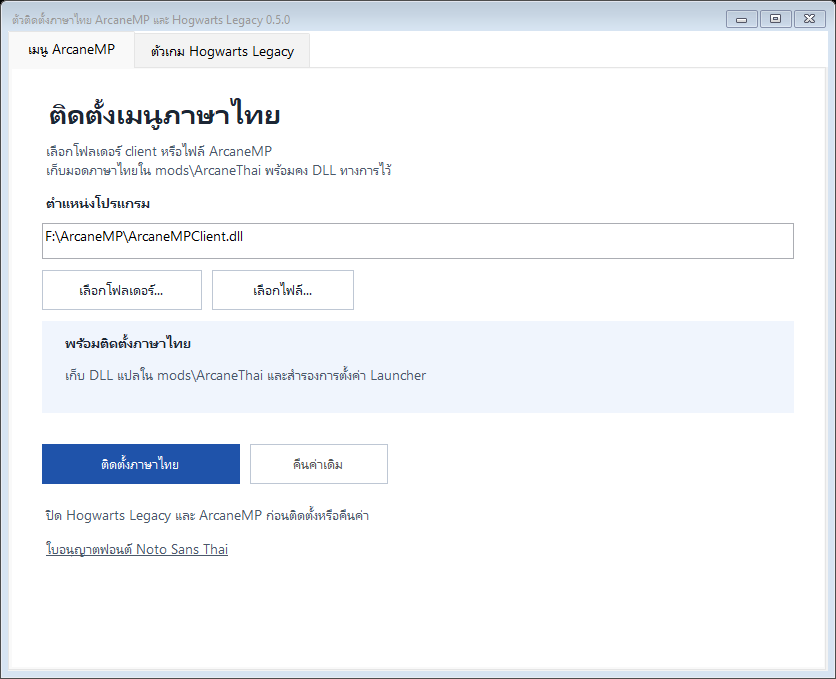
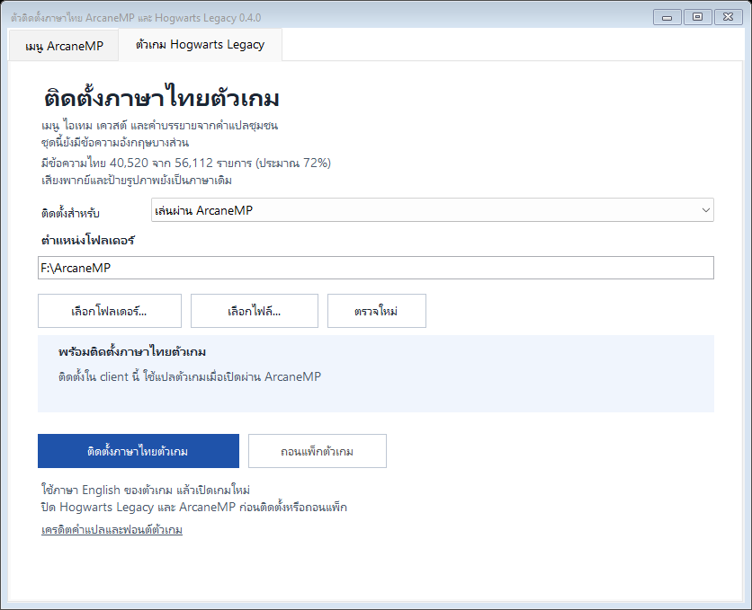
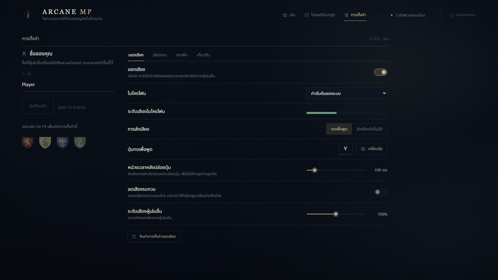

# ArcaneThai Installer 0.4.0

ตัวติดตั้งภาษาไทยแบบ **EXE ไฟล์เดียว** สำหรับเมนู ArcaneMP และข้อความในตัวเกม Hogwarts Legacy แยกเลือกติดตั้งหรือถอนได้จากคนละแท็บ ไม่ต้องติดตั้ง Node.js หรือดาวน์โหลดแพ็กเพิ่มขณะใช้งาน EXE



## ดาวน์โหลดและใช้งาน

ดาวน์โหลด **ArcaneThaiInstaller.exe** จาก [Releases](https://github.com/QUITFIL3/arcanemp-thai-menu/releases/latest)

1. ปิด Hogwarts Legacy และ ArcaneMP
2. เปิด `ArcaneThaiInstaller.exe`
3. ในแท็บ **เมนู ArcaneMP** กด **เลือกโฟลเดอร์...** หรือ **เลือกไฟล์...** แล้วเลือกตำแหน่งไคลเอนต์
4. เมื่อขึ้น **พร้อมติดตั้งภาษาไทย** ให้กด **ติดตั้งภาษาไทย**
5. เปิดเกมผ่าน ArcaneMP ใหม่

**ถ้าใช้รุ่น 0.1/0.2 แล้วถูกขอให้อัปเดต 1.13.0 ซ้ำ:** สาเหตุคือรุ่นเดิมแก้ `ArcaneMPClient.dll` ทำให้ checksum ไม่ตรงกับไฟล์ทางการ รุ่น 0.3 แยก DLL ภาษาไทยออกมาเพื่อแก้ปัญหานี้ ถ้า Launcher เพิ่งอัปเดตคืนไฟล์ทางการแล้ว ให้ติดตั้งด้วย EXE รุ่นนี้ได้เลย ถ้ายังเป็นแพตช์เก่า ตัวติดตั้งจะคืน DLL จากไฟล์สำรองที่ตรวจสอบตรงกับรายการอัปเดตก่อน หากไม่พบ จะให้ซ่อมไฟล์ผ่าน Launcher ก่อน

ถ้าต้องการย้อนกลับ ให้เลือกตำแหน่งเดิมแล้วกด **คืนค่าเดิม** ตัวติดตั้งจะคืนค่าการเลือก DLL ของ Launcher และเก็บ DLL ภาษาไทยไว้ในโฟลเดอร์สำรอง โดยคง DLL ทางการปัจจุบันไว้ การตั้งค่าเกมอื่นที่เปลี่ยนหลังติดตั้งยังอยู่

ใช้งานบน Windows 10/11 x64 ที่มี .NET Framework 4.8

## ติดตั้งภาษาไทยตัวเกม



1. ปิด Hogwarts Legacy และ ArcaneMP Launcher
2. เปิดแท็บ **ตัวเกม Hogwarts Legacy**
3. เลือก **เล่นผ่าน ArcaneMP** แล้วเลือกโฟลเดอร์ client เช่น `D:\ArcaneMP` หรือเลือก **ตัวเกมปกติ (Steam / Epic)** แล้วเลือกโฟลเดอร์ Hogwarts Legacy ที่มี `Phoenix`
4. กด **ติดตั้งภาษาไทยตัวเกม**
5. ใช้ภาษา **English** ของตัวเกม แล้วเปิดเกมใหม่

| รูปแบบ | ตำแหน่งแพ็กที่เพิ่ม | ใช้งานเมื่อ |
|---|---|---|
| เล่นผ่าน ArcaneMP | `client\files\paks\zArcaneThai_Community_P.pak` | เปิดเกมผ่าน ArcaneMP client ที่เลือก |
| ตัวเกมปกติ | `Hogwarts Legacy\Phoenix\Content\Paks\~mods\zArcaneThai_Community_P.pak` | เปิดตัวเกมปกติ และเส้นทางที่รองรับการโหลด PAK |

แพ็กนี้เพิ่มข้อความไทยบางส่วนให้เมนู ไอเทม เควสต์ และบทบรรยาย รวม **40,520 จาก 56,112 รายการ (72.2%)** คำแปลที่ยังไม่มีหรือมีแท็กไม่ตรงยังคงเป็นอังกฤษ ไม่มีเสียงพากย์ไทยหรือป้ายรูปภาพ เป็นการปรับใช้คำแปลชุมชน ไม่ใช่การแปลใหม่ครบทั้งเกม

| ชุดข้อความ | ทั้งหมด | มีอักษรไทย | คงอังกฤษ |
|---|---:|---:|---:|
| MAIN | 21,157 | 15,733 | 5,424 |
| SUB | 34,955 | 24,787 | 10,168 |

การนับเป็นจำนวนรายการที่มีอักษรไทย ไม่ใช่การรับรองคุณภาพทุกประโยค สร้างจากข้อมูลเกมรุ่นที่ตรวจในเครื่องพัฒนา ไม่รับรองเกมทุกแพตช์ และยังไม่ได้ทดสอบเปิดเกมจริงจาก Epic ในเครื่องเพื่อน การติดตั้งแพ็กแปลไม่ได้แก้ปัญหา Launcher ตรวจไม่พบเกม Epic

ถอนเฉพาะส่วนนี้ด้วยปุ่ม **ถอนแพ็กตัวเกม** ไฟล์ที่ตรง checksum จะถูกย้ายไป `thai-pack-backups` หากมีแพ็กชื่อเดียวกันที่เนื้อหาต่างกัน ตัวติดตั้งจะเก็บไฟล์นั้นไว้และหยุด ไม่มีการเขียนทับ executable, PAK หลัก, เซฟ หรือมอดอื่น การติดตั้งตัวเกมไม่เปลี่ยน DLL เมนูหรือการตั้งค่า Launcher

## เวอร์ชันโปรแกรมเดิม

ตัวติดตั้ง **ไม่อัปเกรดหรือดาวน์เกรด ArcaneMP และไม่เปลี่ยนข้อมูลเวอร์ชันของ client**

- เก็บ `ArcaneMPClient.dll` ทางการไว้โดยไม่แก้ไข สำหรับรายการอัปเดตที่มีอยู่จะตรวจ checksum จาก `.mafiahub/build-manifest.json` โดยไม่แก้รายการนั้น
- สร้าง `ArcaneMPClient.Thai.dll` จาก DLL ปัจจุบัน เพิ่มคำแปลกับฟอนต์เฉพาะส่วน HTML โดยรักษา JavaScript ขนาดไฟล์ และข้อมูลนอกเมนูทุกไบต์
- เปลี่ยนเฉพาะค่า `mod_dll_name` ใน `ArcaneMP_launcher.json` ให้ใช้ DLL ภาษาไทย ผ่านความสามารถที่มีใน [Framework Launcher](https://github.com/MafiaHub/Framework/blob/develop/code/framework/src/launcher/project.cpp) และรักษาค่าอื่นไว้
- เก็บสำเนาไฟล์กับการตั้งค่าไว้ใน `client\thai-menu-backups\<เวลา>\` และเก็บสถานะใน `arcane-thai-menu.json`
- ตรวจหา HTML จากไฟล์จริง ไม่ล็อกเลขเวอร์ชันหรือตำแหน่งไบต์ตายตัว อ่านแพตช์แบบบีบอัดจากรุ่นก่อนเพื่อย้ายไปติดตั้งแบบแยกไฟล์ได้

การรองรับขึ้นกับ **โครงสร้างเมนูและ Launcher** จึงยังไม่รับรองทุกเวอร์ชันในอนาคต หากอ่านโครงสร้างไม่ได้ พบเมนูกำกวม หรือมีพื้นที่ไม่พอ จะหยุดโดยไม่แก้ไฟล์ **หลัง ArcaneMP อัปเดตเป็นรุ่นใหม่จริง ให้เปิด EXE นี้และติดตั้งภาษาไทยซ้ำก่อนเข้าเกม** เพื่อสร้าง DLL ภาษาไทยจาก client รุ่นใหม่ ตัวติดตั้งจะแจ้งว่าต้องปรับภาษาไทยเมื่อ checksum ของต้นฉบับเปลี่ยน รุ่นนี้ไม่ได้ทำระบบปรับภาษาไทยอัตโนมัติขณะ Launcher อัปเดต

## ภาษาไทยครอบคลุมอะไร

เมนูเล่น ไปรษณีย์นกฮูก การตั้งค่าแชตเสียง เสียงเกม กราฟิก และเกี่ยวกับ พร้อมฟอนต์ที่รองรับสระและวรรณยุกต์ แปลข้อความบนหน้าจอโดยรักษารหัส event และค่าของปุ่มไว้



ชื่ออุปกรณ์ ชื่อเซิร์ฟเวอร์ ข้อมูลที่ผู้เล่นกรอก และข้อความใหม่ที่ยังไม่มีคำแปลอาจยังแสดงอังกฤษ หน้าเมนู client ใช้แท็บแรก ส่วนเควสต์และบทบรรยายเลือกติดตั้งผ่านแท็บตัวเกม เมนูที่สร้างโดยเซิร์ฟเวอร์ขึ้นกับ resources ของเซิร์ฟเวอร์นั้น

## การทดสอบ

- ทดสอบว่า DLL ทางการยังตรงกับ checksum ของตัวอัปเดตหลังติดตั้ง รวมการย้ายแพตช์เก่าไปเป็น DLL แยก
- ทดสอบติดตั้งซ้ำ คืนค่า checksum ไฟล์สำรอง การรักษาการตั้งค่าอื่น และการปฏิเสธไฟล์ที่ล็อก พื้นที่ไม่พอ หรือชื่อไฟล์ชนกับไฟล์ของผู้ใช้
- จำลองการอัปเดต client จริง แล้วปรับ DLL ภาษาไทยและคืนค่าโดยไม่ย้อนเวอร์ชัน DLL ทางการ
- ทดสอบติดตั้ง/ถอนแพ็กตัวเกม 24 รายการ ครอบคลุม client, โครงสร้างโฟลเดอร์ Steam/Epic, พาธยาว, ไฟล์ชนชื่อ, แพ็กที่ล็อก, เกมที่กำลังเปิด และการใช้ EXE เดียวโดยไม่มีไฟล์ข้างเคียง
- ตรวจว่าการติดตั้งแพ็กตัวเกมไม่เปลี่ยน DLL ทางการ, manifest ของ updater, การตั้งค่า Launcher, executable ของเกม หรือ PAK หลัก และถอนไม่กระทบมอดอื่น
- ทดสอบกับ PE libraries จำลองที่มี file-version resources `9.8.7.6` และ `7.6.5.4` และตำแหน่งเมนูต่างกัน ยืนยันเวอร์ชัน ขนาด และข้อมูลนอกเมนูไม่เปลี่ยน
- ทดสอบกับสำเนา DLL จริงของ ArcaneMP และสำเนาแพตช์รุ่นก่อน
- ตรวจเมนูที่ได้จาก EXE ด้วย Chromium ทั้ง 4 หมวด รวมฟอนต์ การเลื่อนที่ 1280×720 การสลับโหมดพูด และค่าที่ส่งผ่าน native bridge
- ทดสอบกับ Launcher จริงของ ArcaneMP 1.13.0 เมื่อ 14 พ.ย. 2026: หลังติดตั้ง ล็อกตัวอัปเดตจบด้วย `status=up-to-date`, `message=build_is_up_to_date` โดยไม่ดาวน์โหลด DLL ซ้ำ และตรวจพบ `ArcaneMPClient.Thai.dll` โหลดอยู่ในโปรเซสเกมจริง ส่วน DLL ทางการยังตรง checksum เดิม
- ติดตั้งแพ็กตัวเกมใน client และเปิดถึงเมนู ArcaneMP จริงแล้ว ตัวอัปเดตยังจบด้วย `up-to-date` และเมนู ArcaneMP แสดงไทยได้ การตรวจข้อความตัวเกมในหน้าเล่นจริงยังไม่เสร็จ ภาพตัวอย่างใน repository มาจาก Chromium และการเรนเดอร์ WinForms

## สร้าง EXE จากซอร์ส

ใช้ C# compiler ของ .NET Framework บน Windows ไม่ต้องติดตั้ง npm dependencies เพื่อสร้าง EXE:

```powershell
.\scripts\build-installer.ps1
```

ผลลัพธ์คือ `dist\ArcaneThaiInstaller.exe` ซึ่งฝังคำแปลเมนู ฟอนต์ แพ็กแปลตัวเกม และเครดิตไว้แล้ว ใช้ไฟล์เดียวได้ ตอน build ครั้งแรก สคริปต์จะดาวน์โหลดแพ็กตัวเกมที่ตรึง checksum จาก release 0.4.0 หรือส่งไฟล์ที่มีอยู่เองได้:

```powershell
.\scripts\build-installer.ps1 -GamePackPath "D:\Downloads\zArcaneThai_Community_P.pak"
```

ซอร์ส Git ไม่เก็บไฟล์ PAK ไว้ในประวัติ ส่วนไฟล์ที่ใช้ build เผยแพร่เป็น asset ของ release พร้อม SHA-256

สำหรับทดสอบ engine ให้ส่ง DLL ของคุณเอง โดยทดสอบกับสำเนาภายใน `.local/`:

```powershell
.\tests\installer.ps1 -ClientDll "D:\ArcaneMP\client\ArcaneMPClient.dll"
.\tests\game-installer.ps1 -ClientDll "D:\ArcaneMP\client\ArcaneMPClient.dll"
npm ci
npx playwright install chromium
npm run qa:installer
```

คำสั่งวิเคราะห์โดยไม่ติดตั้ง:

```powershell
.\dist\ArcaneThaiInstaller.exe --inspect "D:\ArcaneMP\client" ".\inspection.json"
```

## สคริปต์แพตช์รุ่นแรก

ยังเก็บ builder เดิมที่ผูกกับ DLL 1.13.0 ไว้สำหรับอ้างอิง:

```powershell
npm ci
npm run build:legacy -- --client "D:\ArcaneMP\client"
npm run verify
npm run qa
```

สคริปต์ส่วนนี้ตรวจ SHA-256 แบบเดิม ส่วน EXE ใช้การตรวจโครงสร้างโดยไม่ล็อกเลขเวอร์ชัน

## เครดิต

ตัวโปรแกรมและเมนูต้นฉบับเป็นของผู้จัดทำ [ArcaneMP](https://arcane.mp/) repository ไม่รวม DLL, cache, log, เซฟ หรือข้อมูลเซิร์ฟเวอร์

ฟอนต์ [Noto Sans Thai](https://github.com/google/fonts/tree/main/ofl/notosansthai) ใช้ SIL Open Font License 1.1 ดู [assets/OFL-NotoSansThai.txt](assets/OFL-NotoSansThai.txt) ใบอนุญาตฝังอยู่ใน EXE และเปิดอ่านได้จากหน้าต่างติดตั้ง

คำแปลและฟอนต์ในแพ็กตัวเกมมาจาก [Hogwarts Legacy Thailand Localization](https://github.com/Nasz/Hogwarts-Legacy-Thai-Mod) พร้อมเครดิตผู้ร่วมงานใน [assets/GAME-CREDITS.txt](assets/GAME-CREDITS.txt) และในแท็บตัวเกม ดัดแปลงโดยเก็บ key ของเกมที่ทดสอบไว้ทั้งหมด และคงอังกฤษสำหรับรายการที่ไม่มีคำแปลหรือแท็กไม่ตรง ข้อมูลผลตรวจต้นฉบับอยู่ใน [assets/game-report.json](assets/game-report.json)

เครื่องมือพัฒนาเพิ่มเติม: [Acorn](https://github.com/acornjs/acorn), [subset-font](https://github.com/papandreou/subset-font), [Playwright](https://github.com/microsoft/playwright)
