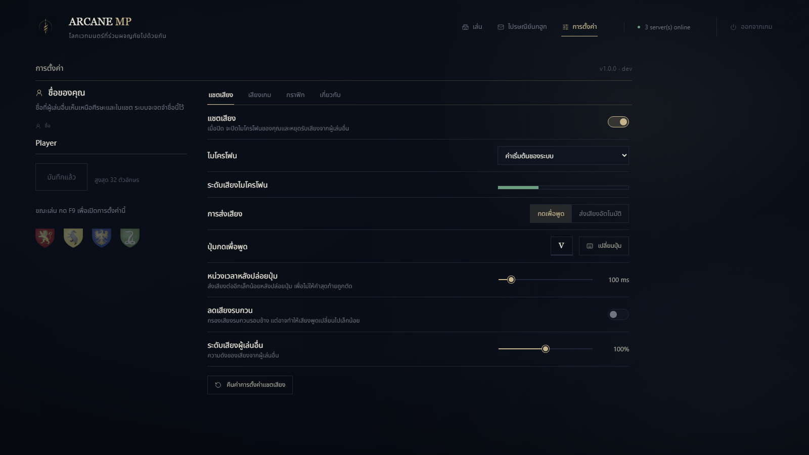

# ArcaneMP Thai Menu

แพตช์ภาษาไทยสำหรับเมนูไคลเอนต์ **ArcaneMP 1.13.0 (`b66abf3`)** แปลเมนูเล่น ไปรษณีย์นกฮูก การตั้งค่าแชตเสียง เสียงเกม กราฟิก และเกี่ยวกับ พร้อมฟอนต์ไทยที่รองรับสระและวรรณยุกต์



## สถานะ

- แปลข้อความ 241 ตำแหน่ง รวมข้อความใน template
- ทดสอบการแสดงผลทั้ง 4 หมวดการตั้งค่าใน Chromium และการเลื่อนดูปุ่มทั้งหมดที่ 1280×720 ผ่าน
- ทดสอบการส่งค่าปุ่มตั้งค่าแล้ว รหัส `settings:set` และ `voice.noiseSuppression` คงเดิม
- ทดสอบตัวติดตั้ง การติดตั้งซ้ำ และการคืน DLL เดิมผ่าน
- **ยังไม่ได้ติดตั้งหรือยืนยันผลภายในเกมจริง** ภาพตัวอย่างมาจากการทดสอบหน้าเมนูใน Chromium

ชุดนี้แปลหน้าเมนูที่ฝังอยู่ใน `ArcaneMPClient.dll` ส่วนเควสต์ บทบรรยาย และเมนูเซิร์ฟเวอร์เป็นแพ็กแยกกัน ข้อความตอบกลับที่ส่งมาจากเซิร์ฟเวอร์และข้อความบางส่วนที่สร้างจากโค้ด native อาจยังเป็นอังกฤษ

## สร้างแพตช์

ต้องมี Node.js 22 ขึ้นไป และไคลเอนต์ ArcaneMP รุ่นที่รองรับอยู่ในเครื่อง

```powershell
npm ci
npm run build -- --client "F:\ArcaneMP-1.12.2\client"
npm run verify
```

ชื่อโฟลเดอร์ client ไม่ได้ใช้ระบุเวอร์ชัน สคริปต์ตรวจ SHA-256 ของ DLL จริง และจะหยุดหากเป็นรุ่นอื่นหรือมีการแก้ไขมาก่อน

SHA-256 ของ DLL ต้นฉบับที่รองรับ:

```text
15aec613550d2017293416300d514dace14b3cad5ca76a0bf21f29cf589a335f
```

ผลลัพธ์จะอยู่ใน `dist/` ได้แก่ ตัวติดตั้ง ตัวคืนค่า HTML ที่แปลแล้ว payload และรายงาน checksum การ build ยังไม่แก้ไฟล์เกมหรือไคลเอนต์ที่ติดตั้งอยู่

## ติดตั้ง

ปิด Hogwarts Legacy ก่อน แล้วเรียก:

```powershell
.\dist\Install-ThaiMenu.ps1 -ClientPath "F:\ArcaneMP-1.12.2\client"
```

ตัวติดตั้งตรวจเวอร์ชันและ checksum เตรียม DLL ใหม่ ตรวจผลก่อนแทนที่ และเก็บ DLL เดิมไว้ใต้ `client\thai-menu-backups\<เวลา>\ArcaneMPClient.dll` จากนั้นเปิดเกมผ่าน ArcaneMP ใหม่

## คืนเมนูเดิม

ปิดเกมก่อน แล้วเรียก:

```powershell
.\dist\Restore-OriginalMenu.ps1 -ClientPath "F:\ArcaneMP-1.12.2\client"
```

สคริปต์คืนค่าจะทำงานเฉพาะ DLL ที่มี checksum ตรงกับแพตช์นี้ และเลือกสำเนา DLL เดิมที่ตรวจ checksum แล้ว หากมีการอัปเดตหรือแก้ไขอย่างอื่นภายหลัง สคริปต์จะหยุด

## ตรวจหน้าเมนู

หลัง build:

```powershell
npx playwright install chromium
npm run qa
```

QA เปิด payload ที่บีบอัดจริง ตรวจฟอนต์และหน้าเมนูทั้ง 4 หมวด ทดสอบโหมดกดเพื่อพูดและส่งเสียงอัตโนมัติ และจำลอง native bridge เพื่อตรวจข้อมูลที่ส่งกลับ

## วิธีทำงาน

1. ตรวจ DLL ต้นฉบับด้วย SHA-256 แล้วดึง HTML ที่ตำแหน่งที่ตรวจสอบไว้
2. เปลี่ยนข้อความด้วย JavaScript AST โดยรักษาชื่อ event, field, object key และปุ่มคีย์บอร์ด
3. สร้างฟอนต์ย่อยสำหรับอักษรไทยจาก Noto Sans Thai และฝังในหน้าเมนู
4. บีบอัด HTML เพื่อให้ใส่ในพื้นที่เดิมได้ โดยคงขนาด DLL และข้อมูลนอกส่วน HTML ทุกไบต์
5. สร้าง payload และตัวติดตั้งที่มี checksum ของต้นฉบับและผลลัพธ์

ไคลเอนต์รุ่นนี้ใช้ CEF ที่รองรับ `DecompressionStream` เพื่อโหลด HTML ที่บีบอัด โดยไม่ต้องโหลดฟอนต์หรือสคริปต์แปลจากอินเทอร์เน็ต

## ข้อจำกัดและการอัปเดต

- รองรับ DLL รุ่นที่ระบุเท่านั้น
- ตัวอัปเดตของ ArcaneMP อาจคืน DLL เป็นเวอร์ชันทางการ เมื่อไคลเอนต์เปลี่ยนรุ่นต้องตรวจและสร้างแพตช์ใหม่
- การทดสอบ Chromium ยังไม่แทนการทดสอบภายในเกมจริง
- ไฟล์ `dist/`, DLL ของเกม/ไคลเอนต์, cache, log, เซฟ และข้อมูลเซิร์ฟเวอร์ไม่รวมใน repository

## เครดิต

คำแปลและสคริปต์ใน repository นี้จัดทำสำหรับชุดแพตช์นี้ ตัวโปรแกรมและเมนูต้นฉบับเป็นของผู้จัดทำ [ArcaneMP](https://arcane.mp/)

ฟอนต์ [Noto Sans Thai](https://github.com/google/fonts/tree/main/ofl/notosansthai) ใช้ SIL Open Font License 1.1 ดู [assets/OFL-NotoSansThai.txt](assets/OFL-NotoSansThai.txt)

Dependencies: [Acorn](https://github.com/acornjs/acorn), [subset-font](https://github.com/papandreou/subset-font), [Playwright](https://github.com/microsoft/playwright)
